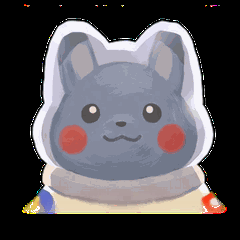

  <!-- Анимированный Hero-баннер в любимых фиолетовых градиентах с Пикачу-космонавтом -->
  

    

  <!-- Эффект плавного появления строк (Typing SVG) в тон палитре -->
  

  <!-- Неоновый переливающийся разделитель -->
  

 

### Обо мне и моем пути

Учусь в **Белорусском государственном университете информатики и радиоэлектроники** (БГУИР, Минск). 

С самого начала меня привлекало не просто написание инструкций для компьютера, а понимание того, как сложные структуры рождаются из простых законов — от строгих математических моделей до живых систем, способных работать автономно.

Мне близка идея созидания от первого лица: когда ты не просто используешь чужие готовые кирпичики, а разбираешься в физике процессов, проектируешь архитектуру целиком и доводишь её до состояния, в котором нет ничего лишнего.

---

### Взгляд на мир и принципы

- **Цифровой суверенитет и приватность**  
  Я убежден, что технологии должны усиливать человека и оставаться его продолжением, а не превращать его в источник данных для сбора телеметрии. Для меня фундаментально важно, чтобы то, что создается, работало локально, надежно и не зависело от капризов облаков или сторонних подписок.

- **Ремесло и решение настоящих задач**  
  Не верю в идеи ради отчетов или создание вещей «для галочки». Если в повседневной жизни, в учебе или среди друзей возникает трение, неудобство или неэффективность — это лучший стимул сесть и спроектировать решение, которое устранит эту боль раз и навсегда.

- **Баланс глубины и тепла**  
  Внутри меня уживаются две стороны: аналитический расчет, интерес к сложным алгоритмам и системной надежности — и искренняя любовь к визуальной эстетике, пиксель-арту, продуманным интерфейсам и уютным персонажам. Именно этот баланс рождает характер всего, к чему я прикасаюсь.

---

  <table border="0" style="border: none; background: transparent;">
    <tr>
      <td width="200" align="center" style="border: none; vertical-align: middle;">
        <!-- Анимированный маскот Пикачу, плавно оглядывающийся по сторонам -->
        
      </td>
      <td style="border: none; vertical-align: middle; padding-left: 20px;">
        <blockquote style="margin: 0; padding: 12px 18px; border-left: 3px solid #8b5cf6; background: rgba(99, 44, 214, 0.08); border-radius: 0 12px 12px 0;">
          <em>«Настоящая сложность должна быть невидимой. Чем глубже и надежнее устроена система внутри, тем проще, спокойнее и естественнее она ощущается снаружи».</em>
        </blockquote>
      </td>
    </tr>
  </table>

   

  <!-- Фирменный футер с плавным переливом градиентов -->
  

